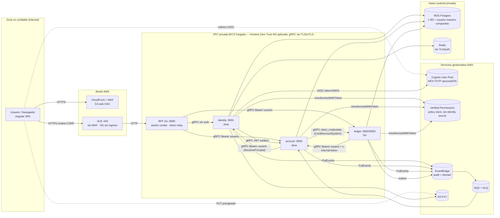

# 01 · Arquitectura actual

Convenciones y alias de ruta: ver [00-INDICE](00-INDICE.md).

## 1. Componentes y responsabilidades

| Componente | Responsabilidad | Interfaz expuesta | Evidencia |
|---|---|---|---|
| **imaginarybank-web** (Angular) | SPA con 3 rutas: `login`, `register` y `home`. En `home` se ven las cuentas, el extracto y se hacen transferencias entre cuentas propias. El login es una redirección completa al BFF. No guarda tokens: usa una cookie de sesión con `withCredentials`. | HTTP (navegador) | `WEB/app.routes.ts:5-24`, `WEB/core/auth/auth.service.ts:22-26`, `WEB/core/interceptors/credentials.interceptor.ts:9-10` [VERIFICADO] |
| **BFF** (Go) | Fachada REST `/api/v1/*` con 17 operaciones. Gestiona la sesión opaca (`__Host-bff_sid`), el CSRF double-submit, la allowlist de redirecciones y un rate limit en memoria. **Reenvía el access token del usuario** a los micros (token relay). No valida JWT ni hace autorización por recurso. | HTTP :8080 | `bff/cmd/bff/main.go:67-77`, `BFF/api/rest/server/router.go:33-85`, `BFF/client/grpc/outgoing_metadata.go:35-64` [VERIFICADO] |
| **identity** (Java) | Onboarding/KYC (S3 presignado), login OIDC con Cognito (PKCE, nonce, state en Redis), sesiones en servidor (tokens cifrados AES-GCM) y `ResolvePrincipal` (sub→customer_id). Orquesta la activación: `CreateCustomer` y `OpenAccountWithOpeningBonus` en account. | gRPC :9091 | `micro/identity/src/main/resources/application.yml:44`, `IDN/application/service/*.java` [VERIFICADO] |
| **account** (Java) | Clientes, cuentas, proyección de saldos (`account_balances`), límites, holds y validación previa a pagos. Bono de apertura de 50 USD a través de ledger. Consume eventos `ledger.journal.posted` desde SQS. | gRPC :9092 | `micro/account/src/main/resources/application.yml:60-63`, `ACC/application/service/AccountService.java:31-41`, `ACC/infra/in/sqs/LedgerPostedConsumer.java:47-90` [VERIFICADO] |
| **ledger/payments** (Go) | Libro mayor de doble entrada (`journal_entries`/`entry_lines`), pagos con saga (validar → hold → asiento), créditos (bono) y extracto. Outbox hacia EventBridge. | gRPC (8082 por defecto, 9093 en Docker) | `LED/application/service/payment_service.go`, `LED/application/service/ledger_service.go`, `micro/ledger/cmd/ledger/main.go:133-147` [VERIFICADO] |
| **Cognito** | IdP: User Pool con login por email, MFA TOTP (OPTIONAL en dev, ON en prod) y un único app client público `bff`. | OIDC/HTTPS | `infra/cloudformation/30-identity-cognito/template.yml:53-104` [VERIFICADO] |
| **Amazon Verified Permissions** | PDP Cedar. Policy store con validación OFF; el esquema y las políticas se cargan con un script. | AWS API | `infra/cloudformation/70-authz-avp/template.yml:20-32`, `infra/cloudformation/scripts/70-avp-apply-schema-policies.ps1:113-207` [VERIFICADO] |
| **EventBridge / SQS** | Bus de auditoría (solo archivo, sin consumidores) y bus de dominio → SQS → account. | AWS | `infra/cloudformation/60-audit-observability/template.yml:117-131`, `infra/cloudformation/80-messaging/template.yml:80-152` [VERIFICADO] |

## 2. Quién llama a quién

| Origen → destino | Tipo | Protocolo / puerto | Llamadas | Credencial | Evidencia |
|---|---|---|---|---|---|
| Navegador → BFF | sync | HTTP(S) :8080 (proxy `/api`) | 17 operaciones REST | Cookie de sesión + `X-CSRF-Token` en mutaciones | `imaginarybank-web/proxy.conf.json:2-13`, `BFF/api/rest/middleware/csrf.go:37-43` [VERIFICADO] |
| Navegador → S3 | sync | HTTPS PUT presignado | Subida KYC | URL presignada (900 s) | `IDN/infra/out/storage/S3PresignedKycStorage.java:97-140` [VERIFICADO] |
| Navegador → Cognito Hosted UI | sync | HTTPS (redirect) | Login | Credenciales del usuario + MFA | `IDN/infra/out/oidc/cognito/CognitoOidcIdpClient.java:33-51` [VERIFICADO] |
| BFF → identity | sync | gRPC en claro (TLS/mTLS opcional) | `StartOidcLogin`, `CompleteOidcLogin`, `GetSessionInfo` (**en cada petición autenticada**), `RefreshSession`, `LogoutSession`, onboarding ×3 | **Ninguna** (sin Authorization), salvo `ActivateRegistration`, que lleva bearer de usuario | `BFF/client/grpc/conn.go:31-66`, `BFF/api/rest/middleware/auth_session.go:120-124` [VERIFICADO] |
| BFF → account | sync | gRPC en claro | `ListAccounts`, `PatchAccountLimits`, `GetAccountByNumber`, `PatchCustomer`, **`InternalAccountsService/ValidateAccountsAndLimits`** | Bearer **del usuario** | `BFF/client/grpc/accounts.go:61-285`, `BFF/api/rest/v1/web/feature/payments/strict.go:101-106` [VERIFICADO] |
| BFF → ledger | sync | gRPC en claro | `PostPayment`, `GetPayment`, `ListAccountStatement` | Bearer del usuario | `BFF/client/grpc/ledgerpayments.go:30-217` [VERIFICADO] |
| identity → account | sync | gRPC en claro (`usePlaintext`) | `CreateCustomer`, `OpenAccountWithOpeningBonus` | **JWT de servicio estático** (`IDENTITY_SERVICE_ACCESS_TOKEN`) | `IDN/infra/config/GrpcClientsConfig.java:19-31`, `IDN/infra/out/grpc/AccountsGrpcClientAdapter.java:44-89` [VERIFICADO] |
| account → identity | sync | gRPC en claro | `ResolvePrincipal` (en cada ruta AUTHZ con `requireCustomerLink`) | Bearer del usuario reenviado | `ACC/infra/out/grpc/IdentityGrpcClientAdapter.java:27-45`, `ACC/infra/security/grpc/AuthzServerInterceptor.java:127-148` [VERIFICADO] |
| account → ledger | sync | gRPC en claro | `CreditAccountSystem` (bono) | Token **client_credentials** de Cognito (`ServiceTokenProvider`, nuevo y sin commitear) | `ACC/infra/out/grpc/LedgerGrpcClientAdapter.java:32-53`, `ACC/infra/security/oauth/ServiceTokenProvider.java:39-106` [VERIFICADO] |
| ledger → account | sync | gRPC (en claro por defecto; TLS de servidor opcional) | `ValidateAccountsAndLimits`, `ReserveHold`, `ReleaseHold`, `BatchGetAccountSummaries` | Bearer del usuario + `x-internal-token` estático (account **no lo verifica**). Batch va sin metadata. | `LED/infra/out/gateway/accounts_http_gateway.go:92-122`, `micro/ledger/internal/infra/config/config.go:99` [VERIFICADO] |
| ledger → EventBridge (dominio) | async | AWS SDK | `payment.posted`, `ledger.posted` (outbox) | IAM | `LED/infra/out/messaging/outbox_worker.go` [VERIFICADO] |
| EventBridge → SQS → account | async | SQS polling cada 2 s | `ledger.journal.posted` → `applyDeltas` | IAM. **No se verifica la autenticidad del evento.** | `ACC/infra/in/sqs/LedgerPostedConsumer.java:47-90` [VERIFICADO] |
| identity / account / ledger → AVP | sync | AWS SDK HTTPS | `IsAuthorizedWithToken` | IAM (`Resource "*"`) | `ACC/infra/security/avp/AvpAuthorizer.java:55-67`, `LED/infra/security/avp/client.go:74`, `infra/cloudformation/50-compute-ecs/template.yml:201-274` [VERIFICADO] |
| identity → Cognito | sync | HTTPS | discovery, token (code+PKCE, refresh), revoke, userInfo | `client_id` (+ secreto si existe) | `IDN/infra/out/oidc/cognito/CognitoOidcIdpClient.java:53-141` [VERIFICADO] |
| \* → EventBridge (auditoría) | async | AWS SDK | `PutEvents`, best-effort | IAM | `ACC/infra/out/audit/AuditPublisher.java:27-45`, `LED/infra/out/audit/eventbridge_audit.go:84-94` [VERIFICADO] |

Incoherencias de puertos y destinos por defecto [VERIFICADO]:

| Servicio | Código por defecto | Docker | Otros valores |
|---|---|---|---|
| ledger | 8082 (`config.go:67`) | 9093 (`micro/ledger/Dockerfile:41`) | ECS 7003 (`infra/cloudformation/50-compute-ecs/template.yml:48-50`) |
| identity / account | 9091 / 9092 | — | ECS 7001 / 7002, sin `GRPC_PORT` |

Además, los destinos por defecto no coinciden con esos puertos:
- El BFF apunta a `identity:9090`, `accounts:9090` y `ledger:9090` (`bff/internal/config/config.go:53-55`).
- Account apunta a `identity:9090` (`micro/account/src/main/resources/application.yml:97-98`).

## 3. Bases de datos por servicio

| Servicio | Base de datos (local) | Esquema / migraciones | En AWS |
|---|---|---|---|
| identity | `identity` en Postgres compartido + Redis (estado OIDC) | `micro/identity/src/main/resources/db/migration/V1__init.sql` (Flyway desactivado por defecto: `application.yml:28`) | **Misma base de datos y mismo usuario maestro que los demás** (`infra/cloudformation/20-data/template.yml:183,190-209`) |
| account | `account` | `V1`–`V4` en `micro/account/src/main/resources/db/migration/` (Flyway desactivado por defecto) | Igual |
| ledger | `ledger` | `micro/ledger/resources/migration/V1__init.sql`, `V2__add_gl_accounts_registers.sql` (contenedor `ledger-migrate`) | Igual |
| bff | `bff` (se crea pero no se usa) | — | — |

- En local se crea una base de datos por servicio con el mismo superusuario: `infra/local/postgres/init/01-create-databases.sql:3-19`. [VERIFICADO]
- En AWS hay **una sola** instancia RDS y los tres secretos contienen el mismo DSN con el usuario maestro. [VERIFICADO]
- Consecuencia: no hay aislamiento de datos entre servicios. [INFERIDO]

## 4. Despliegue: local frente a AWS

| Aspecto | Local (`docker-compose.yml`) | AWS (CloudFormation) |
|---|---|---|
| Red | Una sola red bridge `banknet` y todos los puertos publicados en `0.0.0.0` (`:5-7,25,56,72,115,142,177`) | VPC con 2 subredes públicas y 2 privadas, NAT y endpoints de VPC (ECR, logs, secretsmanager, sts y S3) (`10-network/template.yml`) |
| Entrada | El BFF está comentado; la web se sirve con `ng serve` | CloudFront + WAF para la SPA (`40-edge`) y ALB 443 → BFF por HTTP (`50-compute-ecs/template.yml:288-336`). **El ALB no tiene WAF.** |
| Acceso a los micros | Accesibles directamente desde el host (19091–19093): **se puede saltar el BFF** | Service Connect sin TLS. Los SG de ALB, BFF y micros **no tienen reglas de entrada** (`10-network/template.yml:273-298`), así que nada llega a nada. [VERIFICADO / INFERIDO] |
| Identidad | Cognito real (los `.env` no están en el repo) | Stack 30: un client público, sin resource server, scopes ni grupos |
| Autorización | AVP real vía `~/.aws` montado | Stack 70: policy store sin identity source |
| Secretos | `.env` (ausentes) y credenciales triviales de Postgres en compose | Secrets Manager. El rol de ejecución **no tiene** `GetSecretValue` y la contraseña maestra está en claro en `infra/params/*/20-data.json:13`. |
| Dockerfiles | bff: alpine con usuario no root. identity/account: temurin-25-jre con UID 10001 y `grpc_health_probe` descargado sin checksum. ledger: distroless nonroot. | ECR inmutable con scan-on-push (`00-foundation/template.yml:447-597`) |

**Estado del despliegue AWS.** Hay variables de ECS que no coinciden con las que lee el código:
- `DB_DSN` frente a `SPRING_DATASOURCE_URL`;
- `DOMAIN_EVENT_BUS_NAME` frente a `DOMAIN_EVENTBUS_NAME`;
- `LEDGER_JOURNAL_POSTED_QUEUE_URL` frente a `LEDGER_EVENTS_QUEUE_URL`;
- faltan `COGNITO_*`, `JWT_*`, `AVP_POLICY_STORE_ID` y `GRPC_PORT`.

También faltan parámetros obligatorios en `params/*/50-compute-ecs.json`, los SG no tienen reglas de entrada y el rol no tiene permiso sobre los secretos. [VERIFICADO; detalle en `infra/cloudformation/50-compute-ecs/template.yml:166-489`]

Conclusión: **el stack 50 no puede levantar un sistema funcional tal como está escrito.** [INFERIDO]

Un efecto colateral: identity no define `SPRING_PROFILES_ACTIVE`, así que se ejecutaría con el perfil `local`, que deja **toda la autorización desactivada**. [INFERIDO]

## 5. Diagrama de contenedores con fronteras de confianza

Fronteras de confianza en la práctica:

1. **Internet → borde.** Hay WAF en la SPA, pero no en el API.
2. **Borde → BFF.** Va por HTTP en claro.
3. **BFF → micros.** No hay autenticación de servicio ni TLS por defecto. Los micros reciben el token del usuario y deben validarlo ellos mismos: identity casi no lo hace, account sí, ledger sí.
4. **Micro → micro.** Mezcla tres mecanismos: un token de usuario reenviado, un JWT estático y client_credentials. No hay ninguna identidad de servicio verificable de forma uniforme.

Evidencia en las tablas anteriores.
