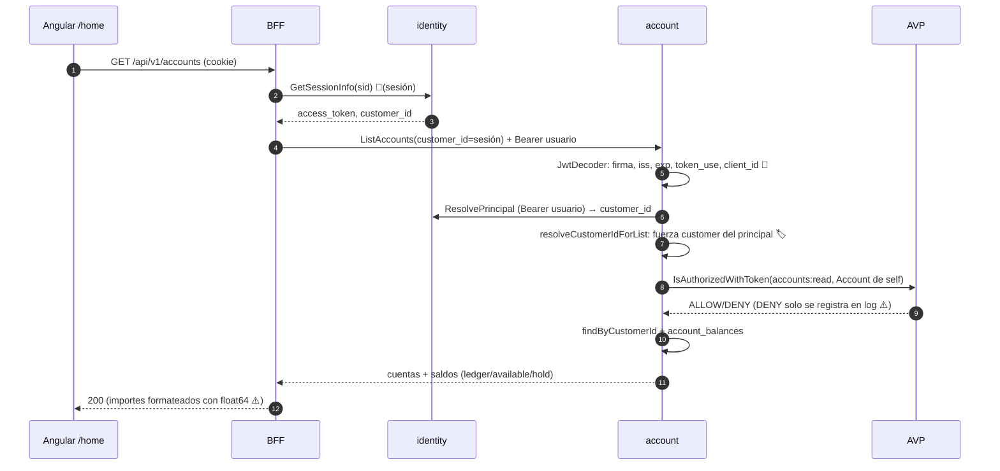
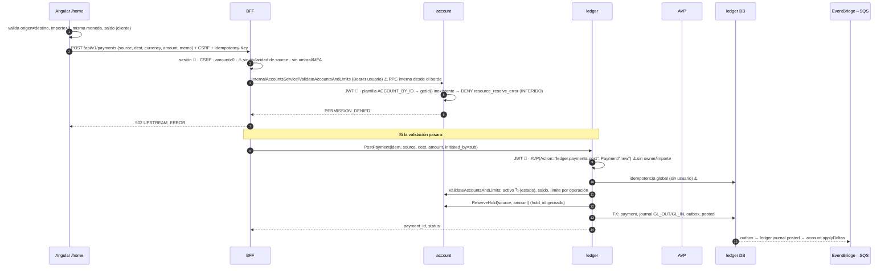

# 03 · Flujos de punta a punta

Convenciones y alias: ver [00-INDICE](00-INDICE.md).

Símbolos usados en los diagramas:

| Símbolo | Significado |
|---|---|
| 🔐 | Se valida la identidad. |
| 🏷️ | Se comprueba la titularidad. |
| ⚠️ | Hay un hueco de seguridad. |

Los flujos se describen **según el código**, suponiendo un perfil distinto de `local`. Los que fallarían en ejecución están marcados.

---

## F1. Login OIDC (Angular → BFF → identity → Cognito)

```mermaid
sequenceDiagram
  autonumber
  participant W as Angular
  participant B as BFF
  participant I as identity
  participant R as Redis
  participant C as Cognito
  participant DB as identity DB
  W->>B: GET /api/v1/auth/oidc/start?redirect=/home
  B->>B: Redirect.Safe(allowlist)
  B->>I: StartOidcLogin(channel, redirect) [gRPC sin auth]
  I->>I: genera state, code_verifier(S256), nonce
  I->>R: SET oidc:state:<state> {verifier, redirect, nonce} TTL 10m
  I-->>B: authorization_url (+state)
  B-->>W: 302 → Cognito Hosted UI ⚠️ state no ligado al navegador
  W->>C: login + MFA (TOTP si OPTIONAL/ON) 🔐
  C-->>W: 302 /api/v1/auth/oidc/callback?code&state
  W->>B: GET callback
  B->>I: CompleteOidcLogin(code, state, ip, ua)
  I->>R: GET + DEL state ⚠️ no atómico
  I->>C: POST /token (code + code_verifier)
  C-->>I: id_token, access_token, refresh_token
  I->>I: valida id_token: firma JWKS, iss, aud, token_use=id, nonce 🔐
  I->>DB: upsert identity(sub) → ACTIVE (reactiva LOCKED/DISABLED ⚠️)
  I->>DB: vincula registro por email (sin email_verified ⚠️)
  I->>DB: crea session (tokens cifrados AES-GCM, TTL 30m / abs 12h)
  I-->>B: session_id, user, roles
  B-->>W: Set-Cookie __Host-bff_sid (HttpOnly) + bff_csrf; 302 /home
```

Evidencias [VERIFICADO]:
- BFF: `BFF/api/rest/server/auth_strict.go:15-102`.
- identity: `IDN/application/service/OidcAuthService.java:71-201` y `IDN/infra/out/cache/RedisOidcStateRepository.java:30-44`.
- Validación del ID token: `IDN/infra/security/OidcIdTokenValidator.java:29-60`.
- Sesión: `IDN/application/service/SessionService.java:93-123`.
- Cookies: `BFF/security/cookies.go:17-57`.

**En cada petición autenticada posterior** el BFF lee la cookie y llama a `GetSessionInfo(session_id)`. Esa RPC es pública en identity y devuelve el access token descifrado, `customer_id`, `user_status` y `sub`. Si al token le quedan 30 s o menos, se ejecuta `RefreshSession` (`BFF/api/rest/middleware/auth_session.go:108-216`). [VERIFICADO]

**Qué valida cada componente:**

| Componente | Qué valida |
|---|---|
| Cognito | Credenciales y MFA. |
| identity | ID token en el login. Luego, solo que el `session_id` exista y no haya caducado. |
| BFF | **No valida el JWT** (`grep jwt` sin resultados). [NO ENCONTRADO] |

---

## F2. Registro / onboarding + apertura de cuenta

```mermaid
sequenceDiagram
  autonumber
  participant W as Angular /register
  participant B as BFF
  participant I as identity
  participant S3 as S3 KYC
  participant A as account
  participant L as ledger
  W->>B: POST /onboarding/intents (PII) [público, sin CSRF]
  B->>I: StartRegistration
  I->>I: reg STARTED, 2 URLs presignadas staging/<regId>/
  I-->>W: registration_id + URLs
  W->>S3: PUT id_front, selfie
  W->>B: POST /onboarding/kyc/confirm(registration_id, objects)
  B->>I: ConfirmRegistrationKyc [PUBLIC ⚠️ sin propietario ni estado previo]
  I->>S3: HeadObject / CopyObject staging→kyc
  I-->>W: KYC_CONFIRMED (proto: UNSPECIFIED)
  Note over W,I: El usuario debe hacer login (F1) para vincular su identidad al registro por email
  W->>B: POST /onboarding/activate(registration_id, datos)
  B->>I: ActivateRegistration ⚠️ BFF no adjunta Bearer en ruta pública
  I->>I: AUTHN_ONLY: JWT 🔐 → assertRegistrationOwner(sub ↔ reg.identityId) 🏷️
  I->>A: CreateCustomer [Bearer = JWT estático de servicio; account PUBLIC]
  A-->>I: customer_id
  I->>I: identity_link(identity, customer) UNIQUE(customer_id)
  I->>A: OpenAccountWithOpeningBonus(SAVINGS, USD) [PUBLIC ⚠️]
  A->>A: grant bono PENDING; crea cuenta (1 por cliente, V4)
  A->>L: CreditAccountSystem(50.00, registration_bonus) [client_credentials]
  L->>L: SERVICE_ONLY: client_id+scope 🔐 · asiento SYSTEM_FUND→CUSTOMER_CASH
  L->>A: ValidateAccountsAndLimits ⚠️ sin Bearer → UNAUTHENTICATED (INFERIDO)
  L-->>A: posted / error
  A-->>I: account_id
  I-->>W: ACTIVATED, customer_id, account_id
```

Evidencias [VERIFICADO]:
- identity: `IDN/application/service/OnboardingService.java:53-259`, `IDN/infra/security/authz/RouteAuthzRegistry.java:16-21` y `IDN/infra/config/GrpcClientsConfig.java:19-31`.
- account: `ACC/infra/security/authz/RouteAuthzRegistry.java:28-34,48-49` y `ACC/application/service/AccountOpeningService.java:40-130`.
- ledger: `LED/infra/security/grpc/authz_interceptor.go:79-115` y `LED/application/service/ledger_service.go:180-324`.

Puntos en los que el flujo probablemente se rompe hoy [INFERIDO]:
1. **Activación.** El BFF no adjunta bearer en las rutas públicas (`BFF/client/grpc/outgoing_metadata.go:59-61`) y identity exige JWT, así que la activación falla con UNAUTHENTICATED, que el cliente ve como 502.
2. **Crédito del bono.** Ledger, en modo `SERVICE_ONLY`, no guarda el token en el contexto. La llamada a account sale sin bearer y account la rechaza (`LED/infra/security/grpc/authz_interceptor.go:93-96`, `ACC/infra/security/grpc/AuthzServerInterceptor.java:101-106`).
3. **Propiedades del token de servicio.** `ServiceTokenProvider` lee `security.service-token.*`, pero en el yml esas claves están bajo `app.security.service-token.*` (`ACC/infra/security/oauth/ServiceTokenProvider.java:24-34`).

**Apertura de cuenta adicional.** No existe para un cliente autenticado: no hay ruta REST para `CreateAccount` y la base de datos impone una cuenta por cliente (`micro/account/src/main/resources/db/migration/V4__initial_account_and_bonus_invariants.sql:49`). [VERIFICADO]

---

## F3. Consultar cuentas y saldo



Evidencias: `BFF/api/rest/v1/web/feature/accounts/strict.go:16-61`, `ACC/infra/in/grpc/validation/AccountsGrpcValidators.java:18-30`, `ACC/infra/security/grpc/AuthzServerInterceptor.java:127-154,269-284` y `ACC/application/service/AccountService.java:135-157`. [VERIFICADO]

- El saldo se lee de la **proyección** `account_balances`, que se actualiza con los eventos SQS de ledger (`ACC/infra/in/sqs/LedgerPostedConsumer.java:47-90`).
- El endpoint de saldo individual (`GetAccountBalances`) no está expuesto en el BFF. Si se invoca directamente contra account, **no comprueba la titularidad de forma efectiva** (ver E2).

---

## F4. Consultar movimientos (extracto)

```mermaid
sequenceDiagram
  autonumber
  participant W as Angular /home
  participant B as BFF
  participant L as ledger
  participant AVP as AVP
  participant A as account
  W->>B: GET /api/v1/accounts/{id}/statement?from&to&page&size
  B->>B: sesión 🔐 · ⚠️ sin comprobar que {id} sea del cliente
  B->>L: ListAccountStatement(account_id={id}) + Bearer usuario
  L->>L: JWT RS256/kid/exp/sub 🔐 (iss/aud solo si configurados)
  L->>L: customer_id requerido (RequireCustomerLink)
  L->>AVP: IsAuthorizedWithToken(Action::"ledger.statement.list", Account/{id}) ⚠️ sin owner, acción fuera de esquema
  AVP-->>L: DENY (INFERIDO: no hay política) → PermissionDenied
  L-->>B: PermissionDenied
  B-->>W: 502 UPSTREAM_ERROR ⚠️
  Note over L,A: Si AVP permitiera: query por counterparty_ref={id} sin filtro de cliente;<br/>enriquecimiento BatchGetAccountSummaries → account (NPE, sin token)
```

Evidencias: `BFF/api/rest/v1/web/feature/accounts/strict.go:191-317`, `LED/infra/security/authz/resource_templates.go:36-41`, `LED/infra/security/avp/client.go:49-60`, `LED/infra/out/persistence/gorm/adapter/journal_repo.go:84-104` y `LED/infra/out/gateway/accounts_http_gateway.go:120-122`. [VERIFICADO / INFERIDO donde se indica]

---

## F5. Transferencia



Evidencias: `WEB/features/home/home.ts:183-234`, `BFF/api/rest/v1/web/feature/payments/strict.go:67-154`, `ACC/infra/security/authz/AccountResourceTemplates.java:65-67`, `LED/application/service/payment_service.go:33-255`, `ACC/application/service/AccountService.java:177-262` y `LED/infra/security/authz/resource_templates.go:27-28`. [VERIFICADO / INFERIDO]

**Datos que viajan** [VERIFICADO]:

| Tramo | Datos |
|---|---|
| Web → BFF | `source_account` y `destination_account` (UUID), `currency`, `amount` (string a partir de `toFixed(2)`) y `memo`, que el BFF ignora. |
| BFF → micros | Bearer del usuario, `x-correlation-id`, `x-route-template`, `x-forwarded-for` (falsificable por `chimw.RealIP`), `x-user-agent` e `idempotency-key`. |

**Dónde se comprueba qué**:

| Comprobación | Dónde | Estado |
|---|---|---|
| Identidad (JWT) | account y ledger | Sí |
| Titularidad del origen | En ningún sitio de forma efectiva | — |
| Estado de cuenta | account `ValidateAccountsAndLimits` / `ReserveHold`, `frozen` | Sí |
| Saldo y límite por operación | account | Sí |
| Umbral / MFA / autenticación reciente | En ningún sitio | [NO ENCONTRADO] |
