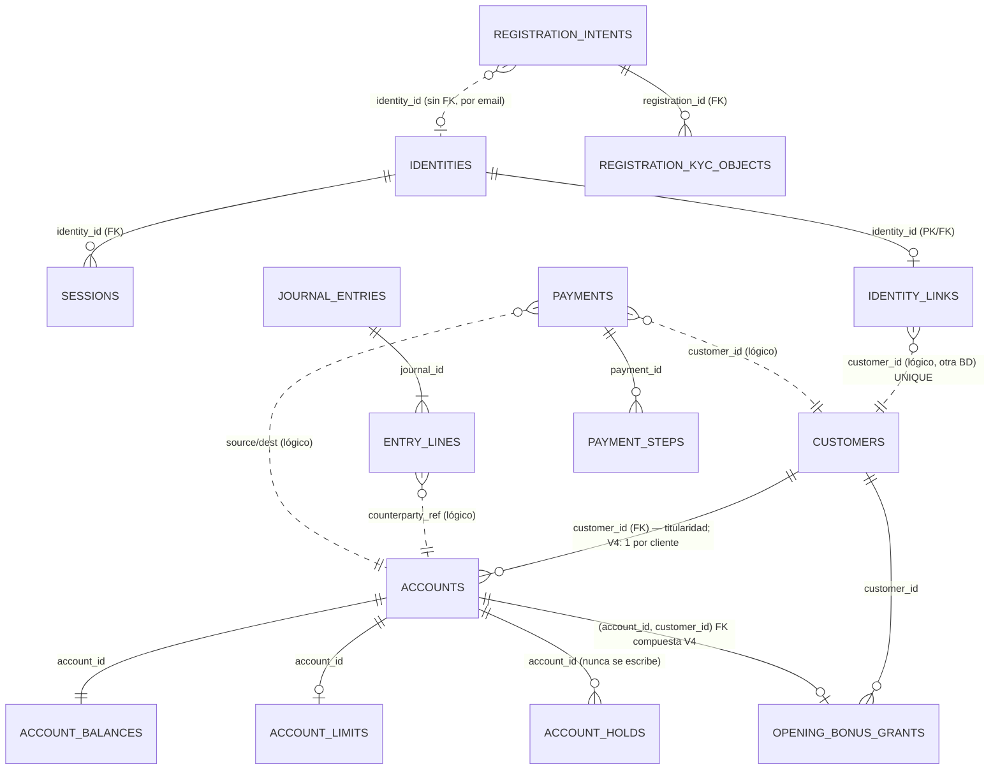

# 05 · Modelo de datos

Convenciones y alias: ver [00-INDICE](00-INDICE.md).

Abreviaturas de las rutas de migraciones:

| Alias | Ruta |
|---|---|
| `ACC-MIG/` | `micro/account/src/main/resources/db/migration/` |
| `IDN-MIG/` | `micro/identity/src/main/resources/db/migration/` |
| `LED-MIG/` | `micro/ledger/resources/migration/` |

## 1. Diagrama entidad-relación (lógico, entre servicios)

Las líneas punteadas son relaciones **lógicas entre bases de datos**, sin integridad referencial. [VERIFICADO / INFERIDO]

## 2. identity (`IDN-MIG/V1__init.sql`, única migración; Flyway desactivado por defecto)

| Tabla | Campos clave | Restricciones | Evidencia |
|---|---|---|---|
| `identities` | `id`, `subject_id_oidc`, `provider`, `user_status` (ACTIVE/LOCKED/DISABLED; solo se usa ACTIVE) | `UNIQUE(subject_id_oidc, provider)` | `:9-25` [VERIFICADO] |
| `sessions` | `session_id`, `identity_id`, `refresh_token_hash` (no se usa), `refresh_token_enc`, `access_token_enc`, `expires_at`, `absolute_expires_at`, `revoked_at`, `rotated_to_session_id`, `ip`, `ua` (no se comparan) | FK a identities con `CASCADE` | `:31-66` [VERIFICADO] |
| `identity_links` | `identity_id` (PK), `customer_id` | **`UNIQUE(customer_id)`**: relación 1:1 entre identidad y cliente | `:72-79` [VERIFICADO] |
| `registration_intents` | PII en claro (email, teléfono, `national_id`, `fingerprint_code`, `monthly_income`), `state`, `customer_id`, `identity_id` (sin FK), `primary_account_id` | Índices | `:85-126` [VERIFICADO] |
| `registration_kyc_objects` | `registration_id`, `kind`, `stage`, `bucket`, `object_key`, `etag` | `UNIQUE(registration_id, kind, stage)` | `:134-170` [VERIFICADO] |

## 3. account (`ACC-MIG/V1`–`V4`; Flyway desactivado por defecto, `ddl-auto: validate`)

| Tabla | Campos clave | Restricciones | Evidencia |
|---|---|---|---|
| `customers` | `id`, `full_name`, `birth_date`, `tin`, **`risk_segment ∈ {low, medium, high}`**, **`status ∈ {active, suspended}`**, `kyc_*` | CHECK | `V1__init.sql:4-15` [VERIFICADO] |
| `accounts` | `id`, **`customer_id` FK → customers (titularidad)**, `product_type ∈ {checking, savings}`, `currency`, **`status ∈ {active, frozen}`**, `account_number` (V2, secuencial desde 11234) | V4: **`uq_accounts_one_per_customer`** | `V1__init.sql:46-56`, `V2__accounts_account_number.sql:2-24`, `V4__initial_account_and_bonus_invariants.sql:49` [VERIFICADO] |
| `account_balances` | `ledger`, `available`, `hold`, todos `numeric(20,6)` | **Sin `CHECK ≥ 0`** | `V1__init.sql:58-63` [VERIFICADO] |
| `account_limits` | **`daily_out`, `daily_in` `numeric(20,6)`**; valor inicial 0 = sin límite | — | `V1__init.sql:65-69`, `ACC/application/service/AccountService.java:93` [VERIFICADO] |
| `account_holds` | `(account_id, hold_id)`, `status`, `idempotency_key` | **Nunca se escribe** | `V1__init.sql:72-84` [VERIFICADO] |
| `idempotency_records` | `key` (UNIQUE global), `operation`, `response_json` | No está ligada a ningún cliente | `V1__init.sql:87-94` [VERIFICADO] |
| `inbox_events` | `event_id`, `status` | Deduplicación SQS | `V1__init.sql:97-104` [VERIFICADO] |
| `account_opening_bonus_grants` | `customer_id`, `account_id`, `journal_id`, `status` (PENDING/COMPLETED), `amount`, `benefit_code` | V4: `amount = 50.00`, `currency = 'USD'`, un bono por cliente y FK compuesta `(account_id, customer_id)` | `V1:106-117`, `V3__opening_accounts.sql:1-17`, `V4__…sql:26-59` [VERIFICADO] |

**Titularidad (cliente ↔ cuenta).** Es la columna `accounts.customer_id`. Se expone a la autorización como el atributo `owner_customer_id` del recurso AVP (`ACC/infra/security/authz/AccountResourceTemplates.java:65-81`). Ningún servicio la compara de forma efectiva con el principal, salvo `ListAccounts`. [VERIFICADO]

**Estado de la cuenta.**
- Solo existen `active` y `frozen`. No hay RPC para congelar ni cerrar una cuenta; solo se puede hacer por SQL. [VERIFICADO / NO ENCONTRADO]
- `frozen` bloquea `ValidateAccountsAndLimits` y `ReserveHold` (`ACC/application/service/AccountService.java:196-197,243`). **No** bloquea `ReleaseHold`, ni la lectura de saldos o límites, ni los deltas SQS. [VERIFICADO]
- `customers.status = suspended` no tiene efecto en ninguna operación. [VERIFICADO]

## 4. ledger (`LED-MIG/V1__init.sql`, `V2__add_gl_accounts_registers.sql`)

| Tabla | Campos clave | Evidencia |
|---|---|---|
| `gl_accounts` | Plan contable. UUID fijos para `GL_SYSTEM_FUND`, `GL_CUSTOMER_CASH`, `GL_OUT` y `GL_IN`. | `V1:7-12`, `V2:1-17`, `LED/domain/model/gl_account.go:23-28` [VERIFICADO] |
| `journal_entries` | `status ∈ {posted, reversed, void}`, `currency char(3)` | `V1:17-24` [VERIFICADO] |
| `entry_lines` | `debit` y `credit` en `numeric(20,6)`, **`counterparty_ref`** (= `account_id` del cliente) | `V1:28-36` [VERIFICADO] |
| `payments` | `idempotency_key` UNIQUE, `amount numeric(20,6)`, `customer_id NOT NULL`, `hold_id`, `journal_id`, `status ∈ {pending, processing, posted, failed}` | `V1:44-58` [VERIFICADO] |
| `payment_steps` | Pasos de la saga | `V1:64-71` [VERIFICADO] |
| `outbox_events` | Se procesan con `FOR UPDATE SKIP LOCKED` | `V1:78-92` [VERIFICADO] |
| `idempotency_records` | `key` UNIQUE global, **sin usuario, sin hash del payload y sin TTL** | `V1:106-113` [VERIFICADO] |

Ledger no guarda saldos ni estados de cuenta; delega en account. [VERIFICADO]

## 5. Importes, precisión y moneda

| Capa | Representación | Riesgo | Evidencia |
|---|---|---|---|
| Web | `number` con `toFixed(2)` | Coma flotante | `WEB/features/home/home.ts:183-234` [VERIFICADO] |
| OpenAPI | `amount: string` sin `pattern`; `currency` de 3 caracteres | — | `bank-bff-openapi/openapi/bff.openapi.yaml:484-496` [VERIFICADO] |
| BFF | Convierte a `float64` para validar `> 0` y para formatear saldos | Coma flotante | `BFF/api/rest/v1/web/feature/payments/strict.go:90-98`, `BFF/api/rest/v1/web/feature/accounts/strict.go:319-321` [VERIFICADO] |
| Proto | `string` decimal; la precisión (20,6) solo aparece en un comentario | — | `bank-contracts/proto/bank/ledgerpayments/v1/ledgerpayments.proto:28` [VERIFICADO] |
| account | `Double.parseDouble`, luego `BigDecimal` con escala 2 y techo 1e9; persistencia `numeric(20,6)` | Pérdida de precisión | `ACC/infra/in/grpc/validation/GrpcValidation.java:156-192` [VERIFICADO] |
| ledger | `shopspring/decimal`. La regex admite 0 y hasta 20 dígitos enteros, frente a 14 en la base de datos. | Overflow devuelve `Internal` | `LED/infra/in/grpc/validation/validation.go:169-182` [VERIFICADO] |
| Cedar | `Payment.amount: Long`, sin decimales | Desajuste de tipos | `infra/authz/cedar/schema.json:57-84` [VERIFICADO] |
| Moneda | Solo USD al crear cuentas y en el bono. Ledger solo valida el formato ISO, sin lista blanca. | — | `ACC/application/service/AccountService.java:62`, `LED/infra/in/grpc/validation/validation.go:87-99` [VERIFICADO] |

## 6. Límites y umbrales

| Concepto | Estado | Evidencia |
|---|---|---|
| Límite diario de salida/entrada | Existe (`daily_out`/`daily_in`), pero **se compara por operación y no como acumulado diario**. Valor inicial 0 = sin límite. Se puede cambiar con `PatchAccountLimits` (roto por la clave de idempotencia). | `ACC/application/service/AccountService.java:93,207-231` [VERIFICADO] |
| Saldo suficiente | `available ≥ amount` en `ValidateAccountsAndLimits`; reserva atómica en `ReserveHold` | `ACC/application/service/AccountService.java:177-250` [VERIFICADO] |
| Máximo de importe | 1e9 (account) | `ACC/infra/in/grpc/validation/GrpcValidation.java:156-192` [VERIFICADO] |
| **Umbral de riesgo para step-up/MFA** | **No existe** en código, esquema, políticas ni configuración | [NO ENCONTRADO] |
| `risk_segment` del cliente | Se almacena pero no se usa. Además, **el propio cliente puede modificarlo** vía `PatchCustomer`. | `ACC/application/service/CustomerService.java:50-73` [VERIFICADO] |
| Bono de apertura | Fijo en 50.00 USD | `V4__…sql:38-47` [VERIFICADO] |
